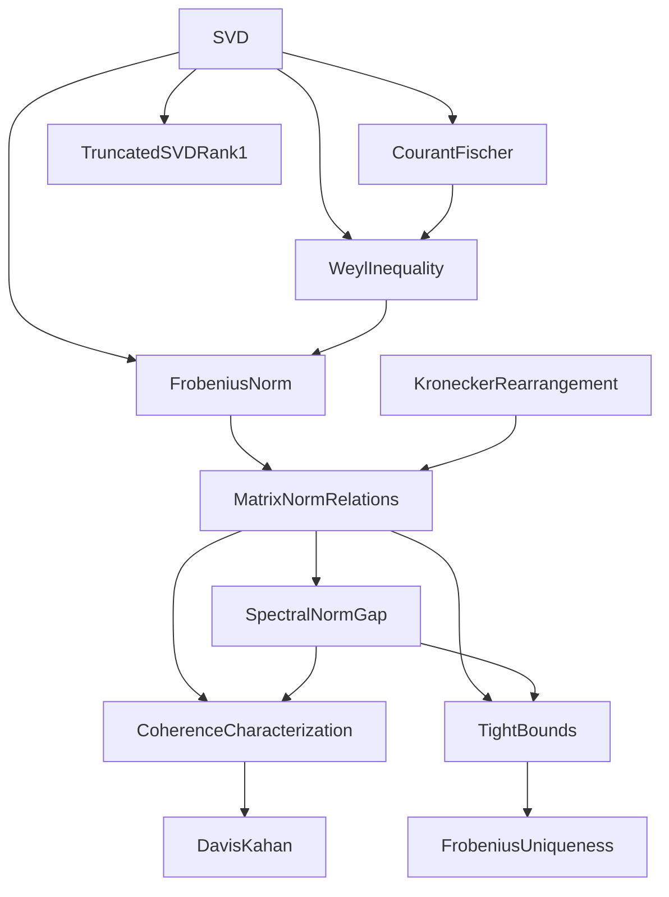

<div align="center">

# FLYWHEEL

**Formalized Linear Algebra in Lean 4**

Machine-checked matrix analysis on Mathlib: the SVD, Courant–Fischer, Weyl and Thompson
interlacing, Eckart–Young (with uniqueness under a gap), Kronecker (Van Loan–Pitsianis)
approximation, and a Davis–Kahan bound for the top eigenvector.

[](https://github.com/acomarce/FLYWHEEL/actions/workflows/lean.yml)
[](.github/workflows/lean.yml)
[](lean-toolchain)
[](https://github.com/leanprover-community/mathlib4/tree/ccbef15ebdb41c2addfac682131f83c75904c3c1)
[](LICENSE)

</div>

## Main results

Matrices are complex and square unless stated otherwise. Singular values σ₀ ≥ σ₁ ≥ ⋯ and
eigenvalues λ₀ ≥ λ₁ ≥ ⋯ are sorted and 0-indexed, as in the code. Aₖ is the rank-k truncated SVD.

| Result | Statement |
|---|---|
| **SVD**<br>`svd_decomposition`<br>`svd_decomposition_rectangular`<br>`Real.svd_decomposition` | A = UΣVᴴ with U, V unitary and Σ diagonal, σᵢ ≥ 0. Also for m × n matrices (Σ rectangular diagonal, σ sorted) and for real matrices (U, V orthogonal). |
| **Norms from σ** (m × n)<br>`spectral_norm_eq_max_singularValue_rect`<br>`frobeniusNorm_sq_eq_sum_singularValues_sq_rect` | ‖A‖₂ = σ₀ and ‖A‖<sub>F</sub>² = Σᵢ σᵢ² |
| **Courant–Fischer**<br>`courantFischer_maxMin_bounds`<br>`courantFischer_minMax_bounds` | For Hermitian A with Rayleigh quotient R: λₖ = max<sub>dim W = k+1</sub> min<sub>0 ≠ x ∈ W</sub> R(x) = min<sub>dim W = n−k</sub> max<sub>0 ≠ x ∈ W</sub> R(x) |
| **Weyl**<br>`weyl_eigenvalue_bounds`<br>`weyl_singularValue_perturbation` | For Hermitian A, B: λₖ(A) + λₙ₋₁(B) ≤ λₖ(A + B) ≤ λₖ(A) + λ₀(B). For any A, B: \|σₖ(A) − σₖ(B)\| ≤ σ₀(A − B) |
| **Thompson interlacing**<br>`thompson_interlacing`<br>`thompson_interlacing_rect` | rank B ≤ r ⇒ σᵢ₊ᵣ(A) ≤ σᵢ(A + B) (square / m × n) |
| **Eckart–Young** (Frobenius)<br>`FrobeniusNorm.eckart_young_frobenius`<br>`eckart_young_frobenius_rect` | rank B ≤ k ⇒ ‖A − Aₖ‖<sub>F</sub> ≤ ‖A − B‖<sub>F</sub> (square / m × n) |
| **Eckart–Young** (spectral)<br>`eckart_young_spectral`<br>`eckart_young_spectral_rect` | rank B ≤ k ⇒ ‖A − Aₖ‖₂ ≤ ‖A − B‖₂ (square / m × n) |
| **Truncation error**<br>`spectral_error_truncatedSVD(_rect)`<br>`frobenius_error_truncatedSVD(_rect)`<br>`truncatedSVD_rect_rank_le` | ‖A − Aₖ‖₂ = σₖ, ‖A − Aₖ‖<sub>F</sub>² = Σ<sub>i≥k</sub> σᵢ² and rank Aₖ ≤ k |
| **Uniqueness** (Frobenius)<br>`eckart_young_frobenius_unique`<br>`eckart_young_frobenius_rect_unique` | σₖ < σₖ₋₁, rank B ≤ k and ‖A − B‖<sub>F</sub> ≤ ‖A − Aₖ‖<sub>F</sub> ⇒ B = Aₖ (square / m × n) |
| **Non-uniqueness** (spectral)<br>`spectral_best_rank_one_not_unique` | For A = diag(2, 1), both diag(2, 0) and diag(3/2, 0) minimize ‖A − C‖₂ over rank C ≤ 1 |
| **Van Loan–Pitsianis**<br>`R_kronecker`<br>`R_frobenius_norm_eq`<br>`kroneckerApprox_optimal` | R(A ⊗ B) = vec(A) vec(B)ᵀ, ‖R(M)‖<sub>F</sub> = ‖M‖<sub>F</sub>, and C̃ = R⁻¹ of the rank-1 truncated SVD of R(C) satisfies ‖C − C̃‖<sub>F</sub> ≤ ‖C − A ⊗ B‖<sub>F</sub> |
| **Kronecker uniqueness**<br>`kroneckerApprox_unique` | σ₁(R(C)) < σ₀(R(C)) and ‖C − A ⊗ B‖<sub>F</sub> ≤ ‖C − C̃‖<sub>F</sub> ⇒ A ⊗ B = C̃ |
| **Kronecker approximation**<br>`kronecker_approx_frobenius_error`<br>`spectral_error_bound_via_R` | ‖C − A ⊗ B‖<sub>F</sub> = ‖R(C) − vec(A) vec(B)ᵀ‖<sub>F</sub> and ‖C − R⁻¹(M)‖₂ ≤ ‖R(C) − M‖<sub>F</sub> |
| **Kronecker norm**<br>`l2_opNorm_kronecker` | ‖A ⊗ B‖₂ = ‖A‖₂ ‖B‖₂ for rectangular A, B |
| **Spectral vs. Frobenius**<br>`spectral_eq_frobenius_rect_iff_rank_le_one`<br>`R_inv_spectral_eq_frobenius_iff_rank_le_one` | ‖E‖₂ = ‖E‖<sub>F</sub> ⇔ rank E ≤ 1 (m × n), and ‖R⁻¹X‖₂ = ‖X‖<sub>F</sub> ⇔ rank R⁻¹X ≤ 1 |
| **Coherence**<br>`coherenceFactorRect_ge_inv_sqrt_rank`<br>`coherenceFactorRect_le_one`<br>`coherenceFactor_eq_one_iff` | μ(E) = ‖E‖<sub>F</sub> / (√rank E · ‖E‖₂) lies in [1/√rank E, 1] for E ≠ 0, and μ(E) = 1 iff the nonzero σᵢ are all equal |
| **Stable vs. effective rank**<br>`stableRank_le_effectiveRank` | (‖E‖<sub>F</sub> / ‖E‖₂)² ≤ exp(−Σᵢ pᵢ log pᵢ) with pᵢ = σᵢ² / ‖E‖<sub>F</sub>², for E ≠ 0 |
| **Davis–Kahan** (top eigenvector)<br>`davis_kahan_top_eigenvector` | A, E Hermitian, ‖E‖₂ < δ = λ₀(A) − λ₁(A), u₀ the top vector of A's eigenvector basis, v a unit top eigenvector of A + E ⇒ ‖v − ⟨u₀, v⟩u₀‖ ≤ ‖E‖₂ / (δ − ‖E‖₂) |
| **Davis–Kahan sin Θ** (top-k, Frobenius)<br>`davis_kahan_sin_theta` | A, E Hermitian, ‖E‖₂ < δ = λₖ₋₁(A) − λₖ(A), P the projection onto A's top-k eigenvectors, ũⱼ the top-k eigenvectors of A + E ⇒ Σⱼ ‖ũⱼ − Pũⱼ‖² ≤ k (‖E‖₂ / (δ − ‖E‖₂))² |
| **Top right singular vector**<br>`top_right_singular_vector_perturbation`<br>`top_right_singular_vector_perturbation_of_spectralGap` | The top-eigenvector bound for AᴴA vs ÃᴴÃ with gap σ₀(A)² − σ₁(A)²; with η = ‖Ã − A‖₂(‖Ã‖₂ + ‖A‖₂) < γ = (σ₀ − σ₁)‖A‖₂ the bound is η / (γ − η) |

Names are abbreviated. [`docs/INDEX.md`](docs/INDEX.md) lists every declaration with its full name,
file, line and summary.

> [!NOTE]
> Uniqueness is proved only in the Frobenius norm and only under the gap σₖ < σₖ₋₁; in the spectral
> norm the repo shows by one counterexample that optima need not be unique. Kronecker factors are
> unique only as the product A ⊗ B, not as the pair (A, B), which can be rescaled. The sin Θ
> bound for k > 1 is the Frobenius form with a factor k, not the operator-norm form, and the
> singular-vector bounds go through AᴴA (square matrices, top right singular vector only): Wedin's
> theorem is not formalized.

## Layout

| File | Contents |
|---|---|
| [`SVD`](src/SVD.lean) | Singular values; square, real and rectangular SVD; norms via σ; rectangular coherence factor |
| [`KroneckerRearrangement`](src/KroneckerRearrangement.lean) | `vec`, the rearrangement `R` and its inverse, Frobenius isometry |
| [`CourantFischer`](src/CourantFischer.lean) | Rayleigh quotients and the min-max theorem |
| [`TruncatedSVDRank1`](src/TruncatedSVDRank1.lean) | rank A ≤ k ⇒ Aₖ = A |
| [`WeylInequality`](src/WeylInequality.lean) | Weyl eigenvalue and singular-value bounds, Thompson interlacing |
| [`FrobeniusNorm`](src/FrobeniusNorm.lean) | Trace formula, unitary invariance, ‖A − Aₖ‖<sub>F</sub>² = Σ<sub>i≥k</sub> σᵢ², Eckart–Young (Frobenius) |
| [`MatrixNormRelations`](src/MatrixNormRelations.lean) | ‖A‖₂ = σ₀, Eckart–Young (spectral), spectral non-uniqueness, ‖A ⊗ B‖₂, Kronecker perturbation bounds |
| [`SpectralNormGap`](src/SpectralNormGap.lean) | Spectral-norm bounds for Kronecker approximation through R⁻¹ |
| [`CoherenceCharacterization`](src/CoherenceCharacterization.lean) | Coherence of the approximation error; Frobenius- vs spectral-optimal rank-1 solutions |
| [`TightBounds`](src/TightBounds.lean) | Rectangular truncated SVD: error formulas, rank bound, Eckart–Young, Van Loan–Pitsianis |
| [`FrobeniusUniqueness`](src/FrobeniusUniqueness.lean) | Uniqueness of the Frobenius-optimal truncation under a gap (square, m × n, Kronecker) |
| [`DavisKahan`](src/DavisKahan.lean) | sin θ bounds for the top eigenvector and top-k eigenspaces; top right singular vector |

<details>
<summary>Import graph (an arrow points to the file that imports)</summary>



</details>

Proof notes: [SVD](docs/svd.md) · [Eckart–Young](docs/eckart-young.md) ·
[Kronecker](docs/kronecker.md) · [Davis–Kahan](docs/davis-kahan.md).

## Build

[elan](https://github.com/leanprover/elan) installs the toolchain pinned in
[`lean-toolchain`](lean-toolchain); Mathlib is pinned in [`lake-manifest.json`](lake-manifest.json).

```bash
lake exe cache get   # prebuilt Mathlib, once
lake build           # all 12 libraries
lake build SVD       # one library and its imports
```

Don't run `lake update`: `lakefile.toml` tracks Mathlib `master`, so it would jump past the
pinned revision.

CI builds every library on each push to `main` and each pull request, fails on any `sorry`, `admit` or `axiom`,
and checks that `docs/INDEX.md` is current.

## Citation

```bibtex
@software{flywheel2025,
  author  = {Markovski, Aleksandar},
  title   = {{FLYWHEEL}: Formalized Linear Algebra in Lean 4},
  year    = {2025},
  url     = {https://github.com/acomarce/FLYWHEEL},
  license = {Apache-2.0}
}
```

## References

- C. Davis, W. M. Kahan. The rotation of eigenvectors by a perturbation. III. *SIAM J. Numer.
  Anal.* 7(1), 1–46, 1970.
- C. Eckart, G. Young. The approximation of one matrix by another of lower rank.
  *Psychometrika* 1(3), 211–218, 1936.
- H. Weyl. Das asymptotische Verteilungsgesetz der Eigenwerte linearer partieller
  Differentialgleichungen. *Math. Ann.* 71, 441–479, 1912.
- C. F. Van Loan, N. Pitsianis. Approximation with Kronecker products. In *Linear Algebra for
  Large Scale and Real-Time Applications*, 293–314, 1993.
- R. A. Horn, C. R. Johnson. *Matrix Analysis*, 2nd ed. Cambridge University Press, 2012.
- G. H. Golub, C. F. Van Loan. *Matrix Computations*, 4th ed. Johns Hopkins University Press, 2013.

## License

[Apache 2.0](LICENSE)
